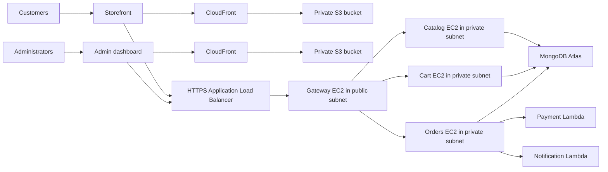

# ShopiTry

ShopiTry is a full-stack e-commerce application and AWS infrastructure project. It combines two React frontends, Node.js services, Terraform-managed AWS resources, Ansible host configuration, and Jenkins pipelines for infrastructure and application deployments.

This repository is also a practical demonstration of infrastructure as code, CI/CD, private networking, service-to-service communication, and static frontend delivery through a CDN.

## Architecture



The gateway is a Node.js service running on EC2; it is not the managed Amazon API Gateway product. The Application Load Balancer provides the public HTTPS entry point for the gateway. The three core services run on EC2, while payment and notification have Lambda implementations.

## Components

| Component | Technology | Deployment target | Purpose |
| --- | --- | --- | --- |
| Storefront | React, Vite | S3 behind CloudFront | Customer shopping experience |
| Admin dashboard | React, Vite | S3 behind CloudFront | Product and order administration |
| Gateway | Node.js, Express, PM2 | Public EC2 instance | Routes API requests and handles authentication |
| Catalog | Node.js, Express, MongoDB | Private EC2 instance | Product catalog |
| Cart | Node.js, Express, MongoDB | Private EC2 instance | Shopping cart |
| Orders | Node.js, Express, MongoDB | Private EC2 instance | Order processing |
| Payment | Node.js | AWS Lambda | Payment function |
| Notification | Node.js | AWS Lambda | Notification function |
| Infrastructure | Terraform | AWS | VPC, EC2, ALB, Lambda, S3, CloudFront, and VPC peering |
| Host configuration | Ansible | EC2 instances | Installs runtime/process manager and configures services |
| CI/CD | Jenkins | Jenkins EC2 instance | Runs infrastructure, configuration, and service deployment jobs |

The application uses MongoDB Atlas for its service databases. The Terraform networking code defines public and private subnets in two availability zones, NAT gateways, and peering with the default VPC used by the Jenkins host. The current EC2 service wiring selects subnet IDs in `us-east-1a`; the subnet layout alone does not mean the service instances are distributed across both AZs.

## Delivery flow

1. Prepare AWS access for the Jenkins EC2 instance using an IAM instance profile/role. Keep SSH private keys and application secrets in Jenkins credentials, not in source files.
2. Create and validate the DNS hosted zone and ACM certificates needed for the frontend domains and API load balancer. DNS records are not managed by the Terraform code in this repository.
3. Run the infrastructure Jenkinsfile. It checks out the repository, initializes and validates Terraform, plans the changes, waits for approval, and applies them.
4. Run the VM configuration Jenkinsfile. It checks SSH connectivity, then runs the Ansible bootstrap playbook against the gateway, catalog, cart, and order hosts.
5. Run the relevant application deployment Jenkinsfile for each backend service or frontend. The repository has separate jobs for the gateway, catalog, cart, orders, payment, notification, storefront, and admin dashboard.
6. Publish the frontend origins/distributions and API load balancer through DNS, then verify the public pages and API health.

See [DEPLOYMENT.md](DEPLOYMENT.md) for the deployment sequence, prerequisites, and configuration notes.

## Repository layout

```text
.
├── ansible/                         # Inventory, playbooks, roles, and templates
├── backend/
│   ├── cart-service/
│   ├── catalog-service/
│   ├── gateway-service/
│   ├── notification-service/
│   ├── order-service/
│   └── payment-service/
├── frontend/
│   ├── admin-dashboard/
│   └── storefront/
├── jenkinsfiles/
│   ├── app-deployment/              # Per-component deployment pipelines
│   ├── configuration-jenkinsfile/   # Ansible configuration pipeline
│   └── infra-jenkinsfile/           # Terraform provisioning pipeline
├── shopitry-infrastructure-terraform/
│   ├── modules/                     # Reusable AWS Terraform modules
│   └── terraform.tfvars.example     # Example input values; customize before use
├── connect_instances.sh             # SSH connectivity check used by Jenkins
├── start-all.js                     # Local backend/Lambda-wrapper launcher
└── DEPLOYMENT.md
```

## Local development

Use Node.js and npm. Each service and frontend has its own `package.json`; there is no root npm workspace.

1. In each backend service directory, install dependencies with `npm ci`.
2. Configure local environment variables for the services you intend to run. Use non-production credentials and do not commit `.env` files.
3. From the repository root, run `node start-all.js` to start the gateway, catalog, cart, orders, and local HTTP wrappers for the payment and notification functions.
4. In separate terminals, run `npm ci` and `npm run dev` from `frontend/storefront` and `frontend/admin-dashboard`.

The launcher uses ports `5000`–`5005` for local backend processes; the frontends use Vite's default development port unless configured otherwise. For service-specific environment variables and commands, consult each component's source and package manifest.

## Documentation map

- This root README is the project overview and repository entry point.
- [DEPLOYMENT.md](DEPLOYMENT.md) explains AWS prerequisites and the Jenkins/Terraform/Ansible deployment order.
- [frontend/storefront/README.md](frontend/storefront/README.md) and [frontend/admin-dashboard/README.md](frontend/admin-dashboard/README.md) are the frontend-specific guides.
- Add a README inside a backend service only when it needs service-specific setup, API, or operational instructions; avoid duplicating the shared deployment guide.

## Notes before using this as a production template

- Review and customize the example Terraform variables, Jenkinsfiles, Ansible inventory, hostnames, and AWS region for your account and environment.
- Terraform expects a pre-existing, encrypted S3 backend with state locking. Bootstrap it before running `terraform init`.
- The Terraform Lambda module currently packages placeholder handlers from its `lambda-placeholder` directories. Verify that the application deployment jobs publish the intended function code.
- The Lambda Function URLs in the Terraform module use unauthenticated access. Add appropriate authorization and restrict access before production use.
- Terraform consumes an ACM certificate ARN; it does not request certificates or create Route 53 records. CloudFront certificates must meet CloudFront's region requirements.
- Do not commit credentials, private keys, tokens, populated `terraform.tfvars`, or production environment files. Use IAM roles and Jenkins credentials, and rotate any credentials that have been committed previously.
